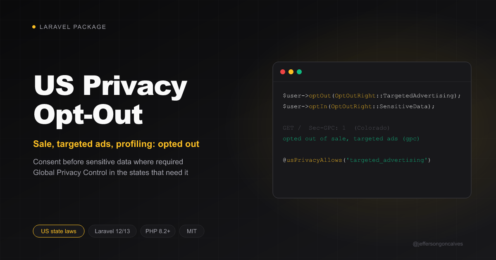

# Laravel US Privacy Opt-Out



[](https://packagist.org/packages/jeffersongoncalves/laravel-us-privacy-opt-out)
[](https://github.com/jeffersongoncalves/laravel-us-privacy-opt-out/actions/workflows/tests.yml)
[](https://packagist.org/packages/jeffersongoncalves/laravel-us-privacy-opt-out)

Consumer choices under the US state privacy laws, on top of [laravel-us-privacy](https://github.com/jeffersongoncalves/laravel-us-privacy):

- **opt-outs** of the sale of personal data, of targeted advertising and of profiling, which every state grants;
- **consent for sensitive data**, which most states require before processing it (Utah and Iowa only require a right to opt out, and Maryland allows only what is strictly necessary);
- **Global Privacy Control** honored as an opt-out of sale and targeted advertising in the states that require universal opt-out mechanisms, from the date each one does.

Every choice is an append-only record with who, when, how (form, gpc, claimed) and the consumer's state.

> This package gives you tooling. It does not make you compliant on its own.

## Installation

```bash
composer require jeffersongoncalves/laravel-us-privacy-opt-out
php artisan vendor:publish --tag="us-privacy-opt-out-migrations"
php artisan vendor:publish --tag="us-privacy-opt-out-config"
php artisan migrate
```

## Recording choices

```php
use JeffersonGoncalves\UsPrivacyOptOut\Concerns\HasOptOuts;
use JeffersonGoncalves\UsPrivacyOptOut\Enums\OptOutRight;
use JeffersonGoncalves\UsPrivacyOptOut\Facades\UsPrivacyOptOut;

class User extends Authenticatable
{
    use HasOptOuts;
}

$user->optOut(OptOutRight::TargetedAdvertising, 'form');
$user->optIn(OptOutRight::SensitiveData, 'form');       // consent for sensitive data
UsPrivacyOptOut::optOut('browser-id', OptOutRight::Sale); // visitors without an account
```

Rights: `Sale`, `TargetedAdvertising`, `Profiling` and `SensitiveData`. The state of the request is stored with each record (pass `state:` to set it yourself).

## Deciding

```php
use JeffersonGoncalves\UsPrivacy\Facades\UsPrivacy;

UsPrivacyOptOut::allows($user, OptOutRight::Sale, UsPrivacy::state('VA'));          // unless opted out
UsPrivacyOptOut::allows($user, OptOutRight::SensitiveData, UsPrivacy::state('CO')); // only with consent
UsPrivacyOptOut::allows($user, OptOutRight::SensitiveData, UsPrivacy::state('UT')); // unless opted out
UsPrivacyOptOut::allows($user, OptOutRight::SensitiveData, null);                   // no state law: true

// The visitor of a request: their state (laravel-us-privacy rulesForRequest), the logged-in user
// or the browser cookie, and a GPC signal where it must be honored.
UsPrivacyOptOut::allowsForRequest($request, OptOutRight::TargetedAdvertising);
```

```blade
@usPrivacyAllows('targeted_advertising')
    {{-- ad pixel --}}
@endusPrivacyAllows
```

## Global Privacy Control

```php
Route::middleware(['web', 'us-privacy.gpc'])->group(...);
```

A request with `Sec-GPC: 1` from a state that requires honoring universal opt-out mechanisms (Colorado, Connecticut, Texas, Montana, Oregon, Delaware, Nebraska, New Hampshire, New Jersey, Minnesota, Maryland) records an opt-out of sale and targeted advertising, once, for the user or the browser. `honor_gpc` is `required` by default; set it to `always` to honor the signal everywhere (unknown states included) or `never`.

## Endpoint

Turn on `route.enabled` for a `POST /us-privacy/opt-out` endpoint behind your "Your Privacy Choices" links: `{right, opted_out}` (`opted_out: false` on `sensitive_data` gives consent). Visitors get a random id in an encrypted cookie; on login their choices are copied onto the account (`claim_on_login`).

## The ledger

Records cannot be updated or deleted (only their IP address and user agent can be deidentified). Each has `right`, `action` (`opted_out`, `opted_in`), `state`, `source`, `ip_address`, `user_agent` and `metadata`. `OptOutRecorded` fires for each.

```php
UsPrivacyOptOut::history($user);
UsPrivacyOptOut::latest($user, OptOutRight::Sale);
```

## Testing

```bash
composer test
```

## Changelog

See [CHANGELOG](CHANGELOG.md).

## License

The MIT License (MIT). See [License File](LICENSE.md).
